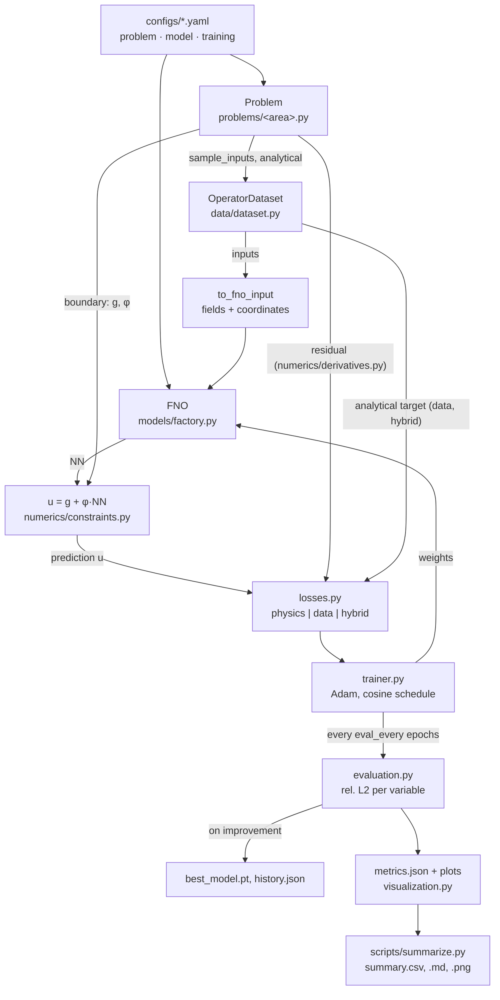

# PINO-Benchmarks

This Project trains Fourier Neural Operators (FNOs) on PDE benchmarks with analytical solutions

## Installation

Requires Python ≥ 3.10.

```bash
conda create -n pinobench python=3.11 -y
conda activate pinobench
pip install torch --index-url https://download.pytorch.org/whl/cu124
pip install -e ".[dev]"
pytest
```

The device is chosen automatically (`device=auto`). Without a GPU everything runs on the CPU.

## Usage

```bash
# one training run: choose problem, model size and mode
python scripts/train.py problem=heat_1d model=fno_small training=physics
python scripts/train.py problem=beam_1d training=data
python scripts/train.py problem=darcy_layered_1d training=hybrid training.weights.data=300

# override single values
python scripts/train.py problem=richards_steady_1d training=physics training.epochs=1000 seed=1

# re-evaluate and re-plot a finished run
python scripts/evaluate.py outputs/heat_1d/physics/<timestamp>

# collect all runs under outputs/
python scripts/summarize.py
```

Each run writes to `outputs/<benchmark>/<mode>/<timestamp>/`:

| File | Content |
|---|---|
| `best_model.pt` | weights with the best test error, rewritten on every improvement |
| `history.json` | loss components and test error per epoch |
| `metrics.json` | rel. L2 per variable (mean, median, max), resolution study, time, parameters |
| `training.png` | loss components and test error with a 5 % line |
| `solution.png` | best, median and worst test example |
| `error_hist.png` | distribution of the rel. L2 over the test set |
| `resolution.png` | rel. L2 against the test resolution |
| `.hydra/config.yaml` | full configuration of the run |

`summarize.py` writes `outputs/summary.csv`, `outputs/summary.md` and `outputs/summary.png`,
using the most recent run per benchmark and mode.

### Training modes

| Mode | Loss | Analytical solution |
|---|---|---|
| `physics` | mean square of the normalized PDE residual | evaluation only |
| `data` | MSE against the analytical solution, normalized per variable | training target |
| `hybrid` | `weights.physics · physics + weights.data · data` | training target |

Defaults: Adam with lr = 1e-3 and a cosine schedule, 500 epochs, batch size 32, 1000 training
and 200 test examples. The best model is selected by the mean rel. L2 of the main variable on
the test set.

## Benchmarks

All quantities are non-dimensional. The reference values are set in the YAML files and are
only used to show the plots in physical units.

| Benchmark | Equation | Operator input | Analytical solution | Main variable |
|---|---|---|---|---|
| `heat_1d` | ∂T/∂t = a ∂²T/∂x², T(0,t) = T(1,t) = 0 | T₀(x) = Σₙ bₙ sin(nπx), N = 5, bₙ ~ U(−1, 1) | T = Σₙ bₙ sin(nπx) exp(−a(nπ)²t) | T |
| `beam_1d` | M″ = −q, w″ = −M/EI, w = M = 0 at both supports | q(x) = q₀ + q₁x with q₀, q₁ ~ U(0, 1); EI ~ U(0.5, 2) | w = q₀x(1−2x²+x³)/(24EI) + q₁x(7−10x²+3x⁴)/(360EI), M = q₀x(1−x)/2 + q₁x(1−x²)/6 | w |
| `darcy_layered_1d` | −(k h′)′ = 0, h(0) = 1, h(1) = 0 | k₁, k₂ log-uniform in [0.1, 10], layer interface xₛ ~ U(0.3, 0.7) | q = 1/(xₛ/k₁ + (1−xₛ)/k₂); h = 1 − qx/k₁ for x < xₛ, else h(xₛ) − q(x−xₛ)/k₂ | h |
| `richards_steady_1d` | d/dz[K(h)(h′ + 1)] = 0, K = Ks e^{αh}, h(0) = 0, h(1) analytical | α ~ U(1, 5), q/Ks ~ U(−0.9, −0.1) | Φ = e^{αh} = −q/Ks + (1 + q/Ks) e^{−αz}, h = ln(Φ)/α | h |

| Benchmark | FNO | Hard constraint | Residual normalization | Reference values |
|---|---|---|---|---|
| `heat_1d` | 2D over (x, t), input T₀, x, t/t_end | T = T₀ + t·x(1−x)·NN | divided by a(Nπ)², the fastest decay rate | non-dimensional |
| `beam_1d` | 1D, input q, EI, x; output w, M | w, M = x(1−x)·c·NN with c = w_c or M_c | curvature by M_c/EI, equilibrium by q̄ = q₀ + q₁/2 | L = 5 m, q_ref = 10 kN/m, EI_ref = 10⁴ kNm²; w in mm, M in kNm |
| `darcy_layered_1d` | 1D, input log₁₀ k, x | h = (1−x) + x(1−x)·NN | flux form: deviation of each face flux from the mean flux, divided by the effective conductivity | L = 10 m, h in m, k_ref = 10⁻⁵ m/s |
| `richards_steady_1d` | 1D, input α, q/Ks, z | h = h(1)·z + z(1−z)·NN | in units of Ks, no further scaling | L = 1 m, Ks = 10⁻⁵ m/s |

The normalizations are explained in the docstrings of the problem classes.


## Data flow



Trainer, losses, evaluation and plots talk to a benchmark only through the `Problem`
interface. Benchmark-specific code lives only in `problems/<area>.py`,
`analytical/<file>.py` and `configs/problem/<name>.yaml`.

To add a benchmark, see [docs/AddBenchmark.md](docs/AddBenchmark.md).
