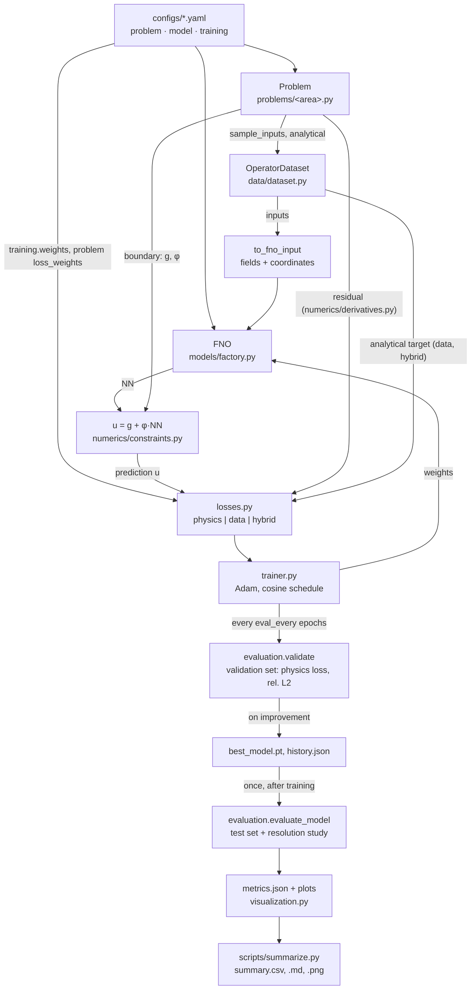

# PINO-Benchmarks

This Project trains Fourier Neural Operators (FNOs) on PDE benchmarks with analytical solutions

## Installation

Requires Python ≥ 3.10.

```bash
conda create -n pinobench python=3.11 -y
conda activate pinobench
pip install torch --index-url https://download.pytorch.org/whl/cu124
pip install -e ".[dev]"
pytest
```

The device is chosen automatically (`device=auto`). Without a GPU everything runs on the CPU.

## Usage

```bash
# one training run: choose problem, model size and mode
python scripts/train.py problem=heat_1d model=fno_small training=physics
python scripts/train.py problem=beam_1d training=data
python scripts/train.py problem=darcy_layered_1d training=hybrid   # uses loss_weights from its YAML

# override single values
python scripts/train.py problem=richards_steady_1d training=physics training.epochs=1000 seed=1

# variants (defaults: the benchmark's original input family, output_param constrained)
python scripts/train.py problem=beam_1d_sine training=physics problem.output_param=unscaled
python scripts/train.py problem=beam_1d training=data problem.output_param=direct seed=1
python scripts/train.py problem=heat_1d training=physics problem.output_param=soft training.weights.bc=100

# re-evaluate and re-plot a finished run (refuses runs with a different wrapper)
python scripts/evaluate.py outputs/heat_1d/sine-constrained/physics/<timestamp>
python scripts/evaluate.py <run_dir> --allow-legacy  # runs without wrapper_version

# collect all runs under outputs/
python scripts/summarize.py

# evaluate a trained model on one hand-made input (see "Exploring a trained model")
python scripts/predict.py heat_1d --inputs 1,0,0.5,0,0 --name half_mode   # newest physics/constrained run
python scripts/predict.py heat_1d --mode data --output-param soft --inputs 1,0,0.5,0,0
```

### Exploring a trained model

`pino.inference` loads a finished run and evaluates its model on one hand-made operator input (`predict_one`):
prediction, analytical solution, rel. L2 and boundary error per variable, on the test grid or
any other resolution. Inputs are given in the problem's own parametrization, the layout of
`sample_inputs` for one example (heat_1d: b₁…b₅; chloride_1d: Cs, D; darcy_poisson_2d: the
4 × 4 coefficients, flattened). Inputs outside the trained range (`Problem.input_ranges()`,
by default the extremes of 20 000 samples, with 1 % tolerance) are evaluated as well but
flagged as extrapolation. Only the operator inputs can be varied: heat_1d with `sine` has no
boundary values among its inputs, heat_1d with `sine_ramp` has
(`scripts/predict.py heat_1d --family sine_ramp --inputs b1,b2,b3,b4,b5,aL,bL,aR,bR`).

Runs are chosen by `find_run(benchmark, mode, output_param, inputs, seed)`, the newest finished
run of that combination by its `metrics.json` timestamp (`inputs` defaults to the original
family, `output_param` to `constrained`, any seed; `_superseded/` is ignored), or by path with
`load_run(run_dir)`; `load_latest(...)` combines both. `load_run` applies the same wrapper
check as `evaluate.py`, taking the wrapper fields from `metrics.json` when `history.json` of an
older run lacks them.

- `scripts/predict.py <benchmark | run_dir> --inputs … [--mode physics] [--output-param constrained]
  [--family …] [--seed …] [--resolution 128 | 64x64x32] [--name …]`; `--show-ranges` prints the
  trained ranges, `--no-save` only prints the result.
- `notebooks/explore.ipynb` does the same interactively with inline plots, e.g. in VS Code
  over SSH (needs `ipykernel`: `pip install -e ".[notebook]"`). Its last part has a ready-to-run
  block per benchmark: named inputs, including some outside the trained range, a table of all
  trained variants against these inputs, and the details and plots of one variant.

Saved predictions go to `<run_dir>/predictions/<name>/` (`inputs.json`, `result.json`,
`prediction.pt`, `solution.png`), next to the model they come from. `summarize.py` only
collects `metrics.json` and ignores them.

Each run writes to `outputs/<benchmark>/<inputs>-<output_param>/<mode>/<timestamp>/`:

| File | Content |
|---|---|
| `best_model.pt` | weights with the best validation score, rewritten on every improvement |
| `history.json` | loss components per epoch (`physics`, `data`, `bc`, `total`), validation physics loss (and `val_bc` for `soft`) and validation rel. L2 |
| `metrics.json` | rel. L2 per variable (mean, median, max), boundary error `bc_error_mean`/`bc_error_max` per variable, resolution study, time, parameters |
| `training.png` | loss components and validation error with a 5 % line and the selected epoch |
| `solution.png` | best, median and worst test example |
| `error_hist.png` | distribution of the rel. L2 over the test set |
| `resolution.png` | rel. L2 against the test resolution |
| `.hydra/config.yaml` | full configuration of the run |

`summarize.py` writes `outputs/summary.csv`, `outputs/summary.md` and `outputs/summary.png`.
It groups by benchmark × `inputs` × `output_param` × mode, takes the most recent run per seed
and reports the mean, minimum and maximum over the seeds. Runs under `outputs/_superseded/`
are ignored.

### Training modes

| Mode | Loss | Analytical solution |
|---|---|---|
| `physics` | mean square of the normalized PDE residual, plus `weights.neumann · L_neumann` for problems with stress or flux conditions | evaluation only |
| `data` | MSE against the analytical solution, normalized per variable | training target |
| `hybrid` | `weights.physics · physics + weights.data · data`, plus `weights.neumann · L_neumann` as in `physics` | training target |

With `output_param: soft` every mode adds `weights.bc · L_bc` (see Variants).

**Neumann loss.** A problem can list conditions on derivative quantities as
`NeumannCondition(edge, quantity, target)`, e.g. `("top", "sigma_yy", -p(x))` or
`("left", "sigma_xy")`; a target of 0 is the default. `Problem.neumann_fields` computes the
quantities with one-sided second-order differences on the edges, and any named field works, so an
insulated edge ∂T/∂n = 0 fits the same way. Then

    L_neumann = mean over the points of all conditions of ((q − target) / s)²

with s from `Problem.neumann_scale`, the RMS of the load or of T_top per sample in the block benchmarks. `weights.neumann`
is 10 in `physics` and `hybrid` and acts for every `output_param`; `loss_weights.neumann` in the
problem YAML replaces it. In `data` it is 0 and only acts when set to > 0 explicitly with
`training.weights.neumann`; the YAML value is not applied there. The component appears in
`history.json` and `training.png`. `metrics.json` reports `neumann_error_mean` and
`neumann_error_max` per condition: the largest deviation on the edge relative to s.

Defaults: Adam with lr = 1e-3 and a cosine schedule, 500 epochs, batch size 32, 1000 training,
200 validation and 200 test examples, each drawn with its own seed.

### Validation, checkpoint and test set

| Mode | Checkpoint selected by (validation set) |
|---|---|
| `physics` | physics loss, without the analytical solution; with `soft` or Neumann conditions the objective physics + `weights.bc` · L_bc + `weights.neumann` · L_neumann |
| `data`, `hybrid` | mean rel. L2 over **all** output variables |

The validation rel. L2 is logged in every mode, in `physics` mode for observation only. The
test set is evaluated once, after training, with the selected checkpoint. `metrics.json` and
the summary report the main variable of each benchmark.

### Loss weights in `hybrid` mode

With the default weights 1:1, `hybrid` is dominated by the physics term in every benchmark,
because the data loss is orders of magnitude smaller (for example 1e-7 against 1e-4). This is
deliberately not calibrated for every problem. A problem YAML may set

```yaml
loss_weights: {physics: 1.0, data: 300.0}
```

which replaces `training.weights` in `hybrid` mode; `physics` and `data` keep their single
fixed term. `bc` (the weight of `L_bc`, default 10 in the training YAMLs) may also be set there and
acts in every mode. Only `darcy_layered_1d` sets it, because its hybrid run did not reach the data
mode's accuracy at 1:1. A command-line override such as `training.weights.data=50` still wins.

### Variants

Two switches in every problem YAML select how hard the learning task is. The defaults are the
original benchmarks.

| Switch | Values | Default |
|---|---|---|
| `inputs` | input families of the benchmark, see the table below | the first one, the original family |
| `output_param` | `constrained`, `unscaled`, `direct`, `soft` | `constrained` |

| `output_param` | Prediction | Modes |
|---|---|---|
| `constrained` | u = g + φ·s·NN, s = `output_scale(inputs)` per sample or 1 | all |
| `unscaled` | u = g + φ·c·NN, c = `output_scale_global` per channel from the YAML (default 1) | all |
| `direct` | u = c·NN, no boundary values | `data` only |
| `soft` | u = c·NN; boundary and initial values through the penalty `L_bc` | all |

g and φ come from `boundary()`, where φ is only the fixed shape part such as x(1−x). Only
`beam_1d` has a per-sample scale s = (w_c, M_c). `output_scale_global` is the RMS of each
output over a large sample of the input family, rounded. Loss normalizations (`data_scale()`, residual
scaling) may still depend on the inputs per sample; they act on the loss, not on the output.
`direct` is refused in `physics` and `hybrid`: without the hard constraint and without a
boundary loss the PDE does not determine the solution.

**Soft constraints.** `soft` predicts like `direct` but adds, in every mode,

    L_bc = mean over the boundary points of ((u − g) / s)²,   weight `weights.bc` (default 10)

The boundary points are exactly those where the hard constraint acts, φ = 0 in `boundary()`, per
output channel: the Dirichlet edges and, for problems in time, the initial time slice
(`Problem.boundary_values`; a test checks the mask against the grid coordinates for every problem). g are the values of
`boundary()` there. s is the data-loss normalization `data_scale()`, otherwise the global
constant c (1 if unset). In `physics` mode the checkpoint is chosen by physics + `weights.bc` · L_bc
on the validation set, because the residual alone does not see the boundary values.
`metrics.json` reports for every variant the boundary error max|u − g| over the boundary
points relative to max|u_exact| over the domain, per test example, as mean (`bc_error_mean`)
and maximum (`bc_error_max`) over the test set; with the hard constraint it is 0.

Variant configs inherit from the base YAML through Hydra `defaults`, e.g.
`configs/problem/beam_1d_sine.yaml`. `output_param` is set as an override. The pilot of all
variants on `beam_1d` is summarized in [docs/VariantPilot.md](docs/VariantPilot.md), the soft
constraints (1D pilot and 2D + t) in [docs/SoftConstraintPilot.md](docs/SoftConstraintPilot.md).

`inputs` names what is sampled, so the same name can mean a different family in another
benchmark. Each problem class lists its families in `SUPPORTED_INPUTS`, the first one is the
default; every other value is refused. `beam_1d` and `heat_1d` have a second family so far.

| Benchmark | `inputs` | Sampled operator input |
|---|---|---|
| `beam_1d` | **`linear`** | q = q₀ + q₁x, q₀, q₁ ~ U(0, 1); EI ~ U(0.5, 2) |
| | `sine` | q = Σ_{n=1}^{8} qₙ sin(nπx), qₙ ~ U(−1, 1)/n; EI ~ U(0.5, 2) |
| `heat_1d` | **`sine`** | T₀ = Σ_{n=1}^{5} bₙ sin(nπx), bₙ ~ U(−1, 1) |
| | `sine_ramp` | as `sine`, plus boundary values linear in time: T(0, t) = α_L + β_L t, T(1, t) = α_R + β_R t, α ~ U(−1, 1), β ~ U(−10, 10); T₀ = (1−x)α_L + xα_R + Σ bₙ sin(nπx) |
| `richards_steady_1d` | **`uniform`** | α ~ U(1, 5), q/Ks ~ U(−0.9, −0.1) |
| `darcy_layered_1d` | **`two_layer`** | k₁, k₂ log-uniform in [0.1, 10], x_s ~ U(0.3, 0.7) |
| `chloride_1d` | **`uniform`** | Cs ~ U(0.5, 1), D ~ U(0.2, 1) |
| `darcy_poisson_2d` | **`sine`** | f = Σ_{m,n=1}^{4} a_mn sin(mπx) sin(nπy), a_mn ~ U(−1, 1) |
| `elastic_block_2d` | **`cosine`** | p = p₀ + Σ_{n=1}^{6} pₙ cos(nπx), p₀ ~ U(0.5, 1), pₙ ~ U(−0.5, 0.5)/n; ν ~ U(0.15, 0.35) |
| `thermoelastic_block_2d` | **`cosine`** | T_top = t₀ + Σ_{n=1}^{6} tₙ cos(nπx), t₀ ~ U(0.5, 1), tₙ ~ U(−0.5, 0.5)/n; ν ~ U(0.15, 0.35) |

Default in bold. `beam_1d` with `inputs: sine`:

| Exact solution | Normalization (loss only) |
|---|---|
| M = Σ qₙ sin(nπx)/(nπ)², w = Σ qₙ sin(nπx)/(EI (nπ)⁴) | q_rms = √(Σqₙ²/2); equilibrium / q_rms, curvature / (M_c/EI) with M_c = q_rms/π²; `data_scale` = (q_rms/(π⁴EI), q_rms/π²), the amplitudes of a single first mode |

`heat_1d` with `inputs: sine_ramp` (`problem=heat_1d_sine_ramp`), so that boundary values can be
varied in a trained model. Operator inputs are b₁…b₅, α_L, β_L, α_R, β_R; the network also sees
T_L(t) and T_R(t), 5 channels instead of 3. Exact solution by lifting:
T = (1−x)T_L(t) + xT_R(t) + w, where w is the sine series of T₀'s b_n plus the response to the
ramp source, truncated after 200 modes (solution accurate to about 1e-5). Results, seed 42,
500 epochs on 64 × 64:

| Variant | Mode | rel. L2 | Worst example | Boundary error max | Error at 32 / 128 / 256 |
|---|---|---|---|---|---|
| constrained | physics | 1.82 % | 8.97 % | 0 | 3.4 / 2.3 / 2.8 % |
| constrained | data | 0.78 % | 2.08 % | 0 | 3.8 / 2.2 / 3.1 % |
| constrained | hybrid | 0.56 % | 1.82 % | 0 | 3.9 / 1.9 / 2.9 % |
| soft (bc 1) | physics | 1.92 % | 6.55 % | 0.77 % | 4.4 / 2.9 / 3.7 % |
| soft (bc 1) | data | 0.60 % | 1.26 % | 1.15 % | 4.0 / 2.1 / 3.0 % |

Every problem class has a `WRAPPER_VERSION`, increased by hand whenever g, φ or the output
scaling change. `metrics.json` and `history.json` store `wrapper_version`, `inputs` and
`output_param`, and `evaluate.py` refuses a run whose values differ from the current code: a
checkpoint holds only NN, so the old heat_1d checkpoints (φ = t·x(1−x), version 1) gave about
2280 % error with the current wrapper (version 2).

### 3D FNO: memory and runtime (2D + t)

The problems in time over two space dimensions use a 3D FNO over (x, y, t); time is the last
grid axis (neuraloperator 2.0.0 is only correct for odd sizes in the last dimension, see the
grid check in `models/factory.py`). Measured with `scripts/measure_step.py` on an NVIDIA
A100-PCIE-40GB: one training step (prediction with the hard constraint, `hybrid` loss,
backward, Adam) of `fno_small` (4 layers, 32 channels, padding 0.25) for chloride_corner_2d
(5 input channels), peak allocated memory and mean time after a warm-up:

| Grid (x × y × t) | Batch | n_modes 16 (18.9 M parameters) | n_modes 8 (2.6 M) |
|---|---|---|---|
| 32 × 32 × 32 | 4 | 1.5 GiB, 34 ms | |
| 32 × 32 × 32 | 8 | 2.8 GiB, 57 ms | 2.6 GiB, 55 ms |
| 32 × 32 × 32 | 16 | 5.4 GiB, 106 ms | 5.2 GiB, 102 ms |
| 32 × 32 × 64 | 8 | | 5.2 GiB, 105 ms |
| 64 × 64 × 32 | 4 | 5.4 GiB, 106 ms | |
| 64 × 64 × 32 | 8 | 10.6 GiB, 202 ms | 10.4 GiB, 199 ms |
| 64 × 64 × 32 | 16 | 20.9 GiB, 394 ms | 20.7 GiB, 391 ms |
| 64 × 64 × 64 | 4 | 10.5 GiB, 208 ms | |
| 64 × 64 × 64 | 8 | 20.8 GiB, 405 ms | |
| 64 × 64 × 64 | 16 | out of memory | |

Memory and time grow linearly with the number of grid points × batch (about 7 ms per example
at 32³); the number of modes changes the parameters but hardly the time (n_modes 12: same
times, 8.3 M parameters). 1000 examples × 500 epochs as in 1D would take 60 min at 32³ and
3.5 h at 64 × 64 × 32.

**Choice** for heat_2d and chloride_corner_2d: grid **32 × 32 × 32**, batch **8**,
`fno_small` with n_modes **16** per axis (= N/2), **200 epochs** of 1000 examples, i.e.
125 steps × 57 ms ≈ 7 s per epoch, ≈ 25 min per run including validation. The problem YAMLs set
`epochs` and `batch_size` in their optional `training` block, which replaces the training
config unless `training.<key>` is given on the command line (allowed keys: `epochs`,
`batch_size`, `lr`, `n_train`, `n_val`, `n_test`, `eval_every`). On this grid the fastest
heat_2d mode decays by exp(−178 Δt) = 0.751 per time step, and the thinnest chloride front
(2√(D_min t₀) = 0.179) spans 5.5 grid points. The resolution study scales space and time
together: 24³, 32³, 48³, 64³.

## Restore points (Sicherungspunkte)

The state after the variant pilot and the cleanup of `outputs/`, before soft constraints and
2D + t, is tagged `pre-phase4` (`git checkout pre-phase4`). The state after Phase 3 is tagged
`pre-variants`. The outputs of that older state are archived outside the repository.

```bash
git checkout pre-variants
tar -xzf ../pino-outputs-pre-variants.tar.gz   # restore outputs/ (run in the repository root)
```

## Benchmarks

All quantities are non-dimensional. The reference values are set in the YAML files and are
only used to show the plots in physical units.

| Benchmark | Equation | Operator input | Analytical solution | Main variable |
|---|---|---|---|---|
| `heat_1d` | ∂T/∂t = a ∂²T/∂x², T(0,t) = T(1,t) = 0 | T₀(x) = Σₙ bₙ sin(nπx), N = 5, bₙ ~ U(−1, 1) | T = Σₙ bₙ sin(nπx) exp(−a(nπ)²t) | T |
| `beam_1d` | M″ = −q, w″ = −M/EI, w = M = 0 at both supports | q(x) = q₀ + q₁x with q₀, q₁ ~ U(0, 1); EI ~ U(0.5, 2) | w = q₀x(1−2x²+x³)/(24EI) + q₁x(7−10x²+3x⁴)/(360EI), M = q₀x(1−x)/2 + q₁x(1−x²)/6 | w |
| `darcy_layered_1d` | −(k h′)′ = 0, h(0) = 1, h(1) = 0 | k₁, k₂ log-uniform in [0.1, 10], layer interface xₛ ~ U(0.3, 0.7) | q = 1/(xₛ/k₁ + (1−xₛ)/k₂); h = 1 − qx/k₁ for x < xₛ, else h(xₛ) − q(x−xₛ)/k₂ | h |
| `richards_steady_1d` | d/dz[K(h)(h′ + 1)] = 0, K = Ks e^{αh}, h(0) = 0, h(1) analytical | α ~ U(1, 5), q/Ks ~ U(−0.9, −0.1) | Φ = e^{αh} = −q/Ks + (1 + q/Ks) e^{−αz}, h = ln(Φ)/α | h |
| `chloride_1d` | ∂C/∂t = D ∂²C/∂x², x ∈ [0, 1], t ∈ [0.01, 0.05]; C(0, t) = Cs, C(1, t) and C(x, t₀) analytical | Cs ~ U(0.5, 1), D ~ U(0.2, 1) | C = Cs erfc(x / (2√(Dt))) (Crank, C₀ = 0) | C |
| `darcy_poisson_2d` | −Δh = f on [0, 1]², h = 0 on the boundary, k = 1 | f = Σ_{m,n=1}^{4} a_mn sin(mπx) sin(nπy), a_mn ~ U(−1, 1) | h = Σ a_mn / (π²(m² + n²)) sin(mπx) sin(nπy) | h |
| `heat_2d` | ∂T/∂t = a ΔT on [0, 1]², t ∈ [0, 0.05], a = 1, T = 0 on the boundary | T₀ = Σ_{m,n=1}^{3} b_mn sin(mπx) sin(nπy), b_mn ~ U(−1, 1) | T = Σ b_mn sin(mπx) sin(nπy) exp(−aπ²(m² + n²)t) | T |
| `chloride_corner_2d` | ∂C/∂t = D ΔC on [0, 1]², t ∈ [0.02, 0.05]; C = Cs on x = 0 and y = 0, x = 1, y = 1 and C(x, y, t₀) analytical | Cs ~ U(0.5, 1), D ~ U(0.4, 1) | C = Cs [1 − erf(x/(2√(Dt))) · erf(y/(2√(Dt)))] (product of two 1D solutions, C₀ = 0) | C |
| `elastic_block_2d` | Navier–Lamé in plane stress, E = 1, on [0, 1]²; sliding supports, see below | p(x) = p₀ + Σ_{n=1}^{6} pₙ cos(nπx), ν | mode 0: v = −p₀(1 − ν²)y, u = 0; modes n ≥ 1: Airy stress function Φ = cos(nπx) f(y), f = A cosh + D y sinh | v |
| `thermoelastic_block_2d` | ΔT = 0 and Navier–Lamé with thermal strain, plane stress, E = α = 1, on [0, 1]²; supports as `elastic_block_2d`, top free of stress; T = T_top on top, T = 0 at the bottom, insulated sides | T_top(x) = t₀ + Σ_{n=1}^{6} tₙ cos(nπx), ν | mode 0: T = t₀y, u = 0, v = (1+ν)t₀y²/2; modes n ≥ 1: T = tₙ cos(nπx) sinh(nπy)/sinh(nπ), stress function F = A cosh + B sinh + C y cosh + D y sinh (Goodier potential for the displacements) | v |

| Benchmark | FNO | Hard constraint | Residual normalization | Reference values |
|---|---|---|---|---|
| `heat_1d` | 2D over (x, t), input T₀, x, t/t_end | `dirichlet_1d_t`: T = T₀ + (t/t_end)·x(1−x)·NN | divided by a(Nπ)², the fastest decay rate | non-dimensional |
| `beam_1d` | 1D, input q, EI, x; output w, M | w, M = x(1−x)·c·NN with c = w_c or M_c | curvature by M_c/EI, equilibrium by q̄ = q₀ + q₁/2 | L = 5 m, q_ref = 10 kN/m, EI_ref = 10⁴ kNm²; w in mm, M in kNm |
| `darcy_layered_1d` | 1D, input log₁₀ k, x | h = (1−x) + x(1−x)·NN | flux form: deviation of each face flux from the mean flux, divided by the effective conductivity | L = 10 m, h in m, k_ref = 10⁻⁵ m/s |
| `richards_steady_1d` | 1D, input α, q/Ks, z | h = h(1)·z + z(1−z)·NN | in units of Ks, no further scaling | L = 1 m, Ks = 10⁻⁵ m/s |
| `chloride_1d` | 2D over (x, t), input Cs, D, x, τ | `dirichlet_1d_t` with C(x, t₀), Cs and C(1, t); φ = τ·x(1−x), τ = (t − t₀)/(t_end − t₀) | per sample divided by Cs/t₀: ∂C/∂t peaks at ≈ 0.24 Cs/t for every D | L = 200 mm, D_ref = 10⁻¹² m²/s, t_ref = L²/D_ref = 4·10¹⁰ s ≈ 1268 a, so t ∈ [12.7, 63.4] a; C in M.-%/binder |
| `darcy_poisson_2d` | 2D over (x, y), input f, x, y | `dirichlet_2d` (Coons patch, here g = 0), φ = x(1−x)y(1−y) | per sample divided by the RMS of f, √(Σa²)/2 | L = 10 m, H = 1 m; f = source / k in 1/m, normalized f̂ = f L²/H, so f = 0.01 f̂ 1/m |
| `heat_2d` | 3D over (x, y, t), input T₀, x, y, t/t_end | `dirichlet_2d_t` with u₀ = T₀ and zero edges: T = T₀ + τ·x(1−x)y(1−y)·NN | divided by aπ²·2M² = 178, the fastest decay rate (as heat_1d) | L and ΔT in the YAML (1 m, 1 K); time non-dimensional, t̂ = a t/L² |
| `chloride_corner_2d` | 3D over (x, y, t), input Cs, D, x, y, τ | `dirichlet_2d_t` with C(x, y, t₀), Cs on x = 0 and y = 0, analytical values on x = 1 and y = 1 | per sample divided by Cs/t₀ (as chloride_1d) | as chloride_1d: L = 200 mm, D_ref = 10⁻¹² m²/s, t_ref ≈ 1268 a, so t ∈ [25.3, 63.4] a; C in M.-%/binder |
| `elastic_block_2d` | 2D over (x, y), input p(x), ν, x, y; output u, v | per channel: u = x(1−x)·c_u·NN_u, v = y·c_v·NN_v, g = 0, c = (0.019, 0.42) | residual and L_neumann divided by the load RMS per sample | L = H = 2 m, E = 30 GPa, p_ref = 10 MPa; u, v in mm, σ in MPa |
| `thermoelastic_block_2d` | 2D over (x, y), input T_top(x), ν, x, y; output T, u, v | per channel: T = y·T_top + y(1−y)·c_T·NN_T, u = x(1−x)·c_u·NN_u, v = y·c_v·NN_v, c = (0.45, 0.026, 0.22) | ΔT by π², all equations and L_neumann divided by the RMS of T_top per sample | L = H = 2 m, E = 30 GPa, α = 10⁻⁵/K, ΔT_ref = 20 K; T in K, u, v in mm, σ in MPa |

The normalizations are explained in the docstrings of the problem classes.

### `elastic_block_2d`: supports and results

```
            p(x) from above: σ_yy = −p(x), σ_xy = 0
         ↓   ↓   ↓    ↓    ↓    ↓   ↓
       ┌─────────────────────────────┐
     ○ │                             │ ○     y
     ○ │   elastic block, plane      │ ○     ↑
     ○ │   stress, E = 1, ν input    │ ○     └→ x
     ○ │                             │ ○
       └─────────────────────────────┘
         ○    ○    ○    ○    ○    ○
```

Sliding supports (○): x = 0 and x = 1: u = 0, σ_xy = 0; y = 0: v = 0, σ_xy = 0. The load enters
only through the top edge: u = v = 0 has zero residual, so without L_neumann the trivial solution
is exact. `n_modes` is 16 at 64 points, below N/2, a lesson from heat_2d. `mechanics_plots = True`
adds `deformation.png` (deformed grid, analytical and FNO, exaggerated) and `stress.png` (FNO
stresses by finite differences).

| Variant | Mode | v | u | σ_xx | σ_yy | σ_xy | Top σ_yy error |
|---|---|---|---|---|---|---|---|
| constrained | physics | 9.06 % | 77.0 % | 21.6 % | 7.4 % | 38.5 % | 3.7 % |
| constrained | data | 0.34 % | 0.81 % | 6.6 % | 6.7 % | 39.7 % | 87.9 % |
| constrained | hybrid | 4.58 % | 15.6 % | 8.2 % | 4.7 % | 22.1 % | 7.4 % |
| soft (bc 1) | physics | 15.5 % | 80.4 % | 21.9 % | 7.7 % | 37.1 % | 4.2 % |
| soft (bc 1) | data | 0.27 % | 0.68 % | 4.3 % | 4.4 % | 31.6 % | 48.1 % |
| direct | data | 0.27 % | 0.70 % | 4.3 % | 4.4 % | 32.7 % | 44.0 % |

`constrained` `physics` misses the 5 % criterion; this was accepted, and the tuning stopped, because
`data` and `hybrid` give working networks. Details, the weight search and the cause are in
[docs/ElasticBlock.md](docs/ElasticBlock.md).

### `thermoelastic_block_2d`: supports and results

The same block and supports, heated on top instead of loaded, with one network for T, u and v. The
top is free of stress: σ_yy = σ_xy = 0. The predicted T enters the mechanics as thermal strain, in
the residual and in the stresses. The sides are insulated through `L_neumann` as T_x = 0, next to the
stress conditions. A harmonic T leaves a free body almost free of stress, so only the supports
restrain it: σ_xx is about 2.6 MPa, σ_yy and σ_xy only about 0.03 and 0.02 MPa. For that reason
`metrics.json` also has `stress_rmse`, the root mean square error of each stress in MPa.

| Variant | Mode | v | T | u | σ_xx | RMSE σ_yy / σ_xy [MPa] | Top σ_yy error |
|---|---|---|---|---|---|---|---|
| constrained | physics | 15.37 % | 8.48 % | 37.5 % | 8.64 % | 0.104 / 0.061 | 3.4 % |
| constrained | data | 0.62 % | 0.33 % | 0.69 % | 1.62 % | 0.107 / 0.055 | 32.9 % |
| constrained | hybrid | 5.54 % | 1.60 % | 5.51 % | 2.56 % | 0.130 / 0.041 | 9.0 % |
| soft (bc 1) | physics | 20.30 % | 13.0 % | 65.5 % | 12.5 % | 0.097 / 0.051 | 3.8 % |
| soft (bc 1) | data | 0.43 % | 0.32 % | 0.65 % | 1.51 % | 0.118 / 0.049 | 33.5 % |
| direct | data | 0.36 % | 0.31 % | 0.56 % | 1.30 % | 0.094 / 0.041 | 23.6 % |

The `data` variants meet the 5 % criterion in T, u and v. `constrained` `physics` and `hybrid` miss
it. No variant predicts σ_yy and σ_xy usefully: the error exceeds the signal. Details and the weight
search are in [docs/ThermoelasticBlock.md](docs/ThermoelasticBlock.md).

### Generic helpers

| Helper | Purpose |
|---|---|
| `evaluation.stress_rmse` | root mean square error of each stress in physical units, for stresses too small for a relative error |
| `numerics.constraints.dirichlet_1d` | stationary 1D, Dirichlet values on both ends |
| `numerics.constraints.dirichlet_1d_t` | 1D in time: initial profile u₀(x) and time-dependent end values u_L(t), u_R(t) |
| `numerics.constraints.dirichlet_2d` | stationary 2D: transfinite (Coons) interpolation of four edge functions |
| `numerics.constraints.dirichlet_2d_t` | 2D in time: g = u₀(x, y) + Coons(edges(t)) − Coons(edges(t₀)), φ = τ·x(1−x)·y(1−y) |
| `numerics.derivatives.laplacian` | second-order Laplacian in any number of dimensions |
| `numerics.derivatives.central_mixed` | second-order mixed derivative ∂²/∂x∂y on the interior |
| `numerics.derivatives.one_sided_d1`, `gradient` | second-order one-sided derivative on an edge; first derivative with central interior and one-sided edges |
| `numerics.derivatives.face_flux`, `conservative_divergence` | fluxes k(u′ + g) on faces and their divergence |
| `pdes.diffusion.diffusion_residual` | ∂u/∂t − D·Δu in any number of space dimensions (time last), Δ via `laplacian`; D scalar or per sample |
| `pdes.elasticity.plane_stress` | σ_xx, σ_yy, σ_xy from u, v, with optional thermal strain ε_th: σ_xx = E/(1−ν²)·[(ε_xx − ε_th) + ν(ε_yy − ε_th)], σ_yy alike, σ_xy = E/(2(1+ν))·(u_y + v_x) |
| `pdes.elasticity.navier_lame_residual` | ∇·σ = 0 in displacement form: E/(1−ν²)·[u_xx + (1−ν)/2·u_yy + (1+ν)/2·v_xy] − E/(1−ν)·∂ε_th/∂x, and the same for v with x and y swapped |
| `problems.base.NeumannCondition` | one condition (edge, quantity, target) of `L_neumann` |


## Data flow



Trainer, losses, evaluation and plots talk to a benchmark only through the `Problem`
interface. Benchmark-specific code lives only in `problems/<area>.py`,
`analytical/<file>.py` and `configs/problem/<name>.yaml`.

To add a benchmark, see [docs/AddBenchmark.md](docs/AddBenchmark.md).
